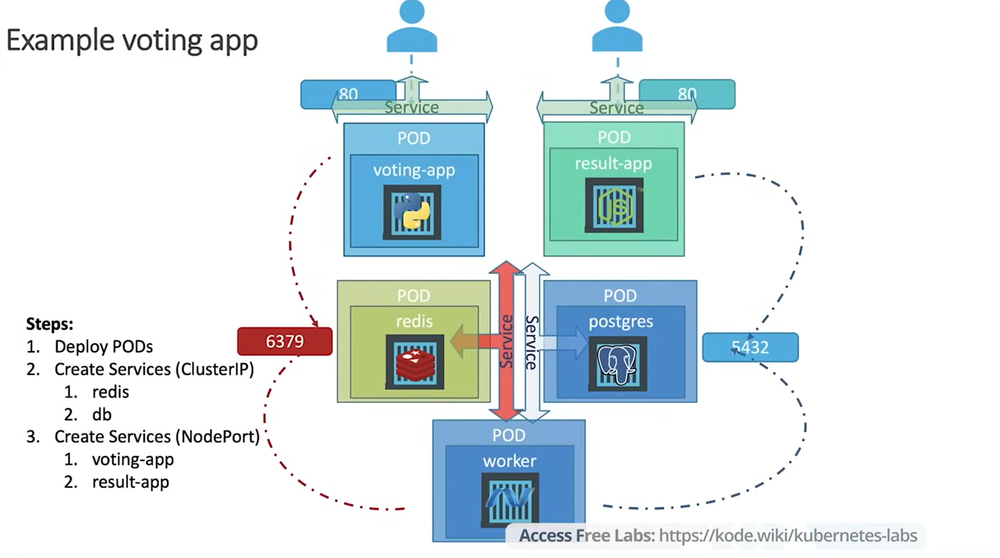

# Voting App Architecture


# Kubernetes Voting App

A multi-tier example voting application deployed on Kubernetes, demonstrating
how to use Pods, Deployments, and Services to run and connect microservices.

## Architecture

| Component    | Tech       | Role                                                   | Service Type |
|--------------|------------|--------------------------------------------------------|--------------|
| voting-app   | Python     | Web UI where users cast their vote (port 80)           | NodePort     |
| result-app   | Node.js    | Web UI that displays live voting results (port 80)     | NodePort     |
| redis        | Redis      | In-memory store that temporarily holds incoming votes (port 6379) | ClusterIP |
| worker       | .NET       | Reads votes from Redis and writes them to Postgres     | none (internal) |
| postgres     | PostgreSQL | Persistent database storing the vote counts (port 5432)| ClusterIP    |

## How it works

1. A user votes through the **voting-app**, which pushes the vote to **Redis**.
2. The **worker** picks up the vote from Redis and stores it in **PostgreSQL**.
3. The **result-app** reads from PostgreSQL and shows the results.

## Deployment steps

1. Deploy the Pods (or Deployments)
2. Create the internal Services (ClusterIP): `redis` and `db`
3. Create the external Services (NodePort): `voting-app` and `result-app`

## Repository structure

Each component has its own manifests:

- `*-pod.yaml` – Pod definition
- `*-deploy.yaml` – Deployment definition
- `*-service.yaml` – Service definition

## Usage

```bash
kubectl apply -f .
kubectl get pods,svc
```

Then open the NodePort URLs for `voting-app` and `result-app` in your browser.

## Credits

Based on the example voting app from [KodeKloud](https://kode.wiki/kubernetes-labs).